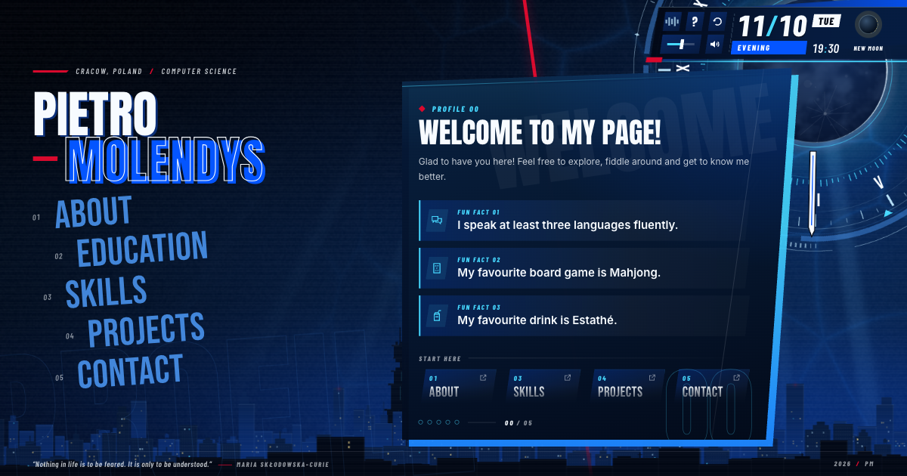

# Pietro Molendys · Portfolio

[](https://github.com/Pedritos22/Pedritos22.github.io/actions/workflows/ci.yml)

**[pedritos22.github.io](https://pedritos22.github.io/)** · [CV (EN)](https://pedritos22.github.io/cv/) · [CV (PL)](https://pedritos22.github.io/cv/pl/)



A personal site built like the pause menu of a late-night JRPG that never existed: deep-sea
blue, moonlight on water, a city asleep and a hidden hour between one day and the next. Almost
everything reacts. In a hurry? The **CV** button (or [`?plain`](https://pedritos22.github.io/?plain))
opens the whole profile on one calm, printable page.

## What's inside

- **No framework, no build step.** Plain ES modules, served as-is by GitHub Pages.
- **WebGL water** at half resolution, a procedural skyline and butterflies, a moon clock you can turn.
- **The descent**: below the pause menu, scrolling goes down into the water, one chapter per depth:
  a manifesto that lights word by word, a quest log whose clock runs as you scroll, the HackNation
  pipeline lighting up step by step, a 3D ring of skill cards, a sideways reel of projects. All
  scroll-driven with CSS custom properties, no scroll library.
- **Motion** with GSAP and the Web Animations API (section wipes run on the compositor).
- **Sound**: a generative lo-fi engine and synthesized effects, all in the browser.
- **English and Polish**, switched in place; every section has its own URL (`/#projects`).
- **A static CV** generated from the same data as the site (HTML and PDF, both languages).
- **Installable and offline-capable** (web app manifest, service worker), hash-based CSP.
- **Side requests**: a Debug Battle against real-world bugs, a rhythm game played to the lo-fi,
  a system console (`~`), a dive below the page and more. The `?` button lists them.

## Run it

```bash
npm run serve          # python3 -m http.server 8000, then open http://localhost:8000
```

QA flags: `?nointro`, `?intro`, `?nofx`, `?darkhour`, `?seed=abc`, `?lang=pl`, `?plain`,
`?perfprobe`. See [DESIGN.md](DESIGN.md) for the rest.

## Tests and tools

```bash
npm install                    # test runner and axe (dev only)
npm test                       # unit tests: pure modules, content, translations, index.html guards
npx playwright install chromium
npm run test:e2e               # browser tests: desktop, laptop, mobile; deep links, language, axe
npm run cv                     # rebuild cv/, sitemap.xml, llms.txt and the CV PDFs from js/content.js
npm run projects               # refresh data/projects.json from the GitHub API
```

On every push, [CI](.github/workflows/ci.yml) runs the unit and browser tests, checks that the
generated files are current and runs Lighthouse. A daily
[workflow](.github/workflows/projects.yml) refreshes the projects snapshot.

## Where things are

| Path | What |
|---|---|
| [`DESIGN.md`](DESIGN.md) | Art direction, tokens, motion rules, architecture and contracts |
| [`js/content.js`](js/content.js) | Every word the site says, in English and Polish |
| [`js/main.js`](js/main.js) | Bootstrap: first-paint modules, then the side requests on idle |
| [`css/`](css) | One stylesheet per component, tokens in `base.css` |
| [`tools/`](tools) | CV generator, projects snapshot, modulepreload list |
| [`tests/`](tests) | Unit tests (`node --test`) and browser tests (`tests/e2e`) |

The look is inspired by the menus of Persona 3 Reload, but nothing is taken from the game: all
art is procedural or hand-written SVG, the music is generated live and the sounds are
synthesized or the owner's own.
